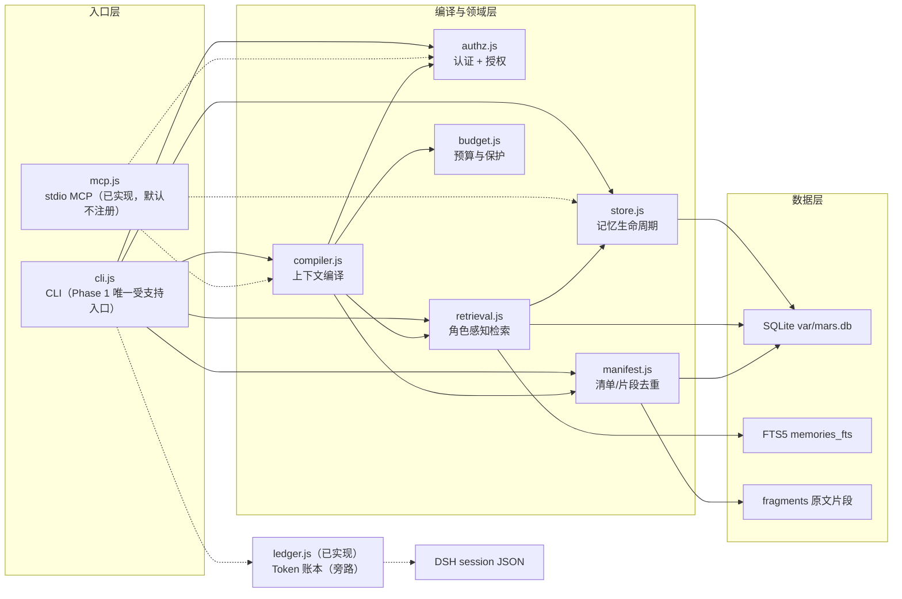
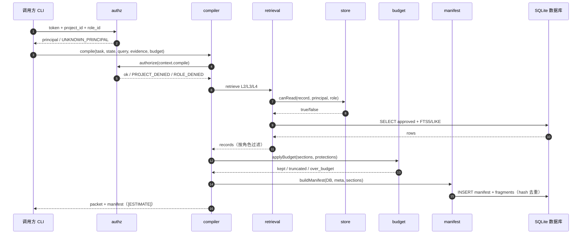
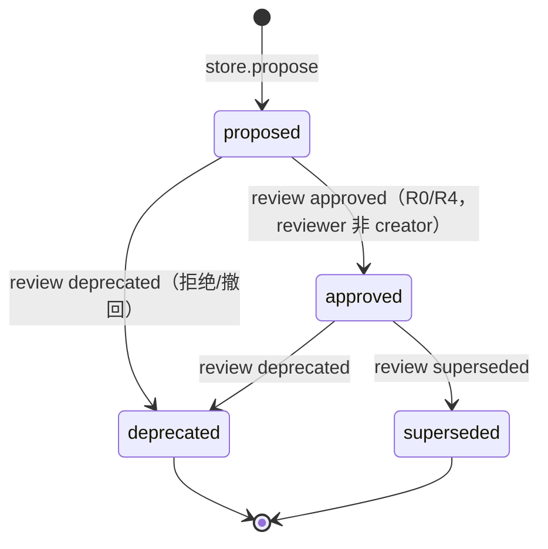

# MARS Phase 1 架构设计

| 项 | 值 |
|---|---|
| 文档 | MARS Phase 1 架构设计（R1） |
| 版本 | v1.2 |
| 修改人 | R1-架构 |
| 日期 | 2026-11-03 |
| 变更摘要 | 按 R4 P5/P6 修正类型过滤与测试规模；同步 R0 对 `restoreFragment/manifest/validate/CLI` 的修复；更新 L 项状态；新增 v1.2 修订记录 |
| 状态 | 设计基线候选（v1.2 收口）；不构成开发授权 |
| 依据 | `docs/interfaces.md` v0.1.0、`docs/security.md`、`docs/mcp.md`、`contracts/*.json`、`config/role-routing.json`、`src/*.js`、`tests/`、`README.md` |
| 读者 | R0、R2、R3、R4、R6、R7 |
| 代码快照 | 2026-11-03（t87 v1.2 收口，+08），全量测试 54/54 |

阅读约定：

- **[FACT]**：来自当前契约、配置或源码，可直接复核。
- **[DESIGN]**：Phase 1 的目标设计，尚未全部落地。
- **[GAP]**：当前实现与契约/目标不一致，或尚未实现；不阻塞本文件成立，但阻塞对应验收项。
- **[ESTIMATE]**：Token 为启发式估算，不是模型 tokenizer 的精确值。

---

## 0. 摘要

- **[FACT]** MARS 是 RDS 内部的**记忆与上下文编译子系统**，不是 Agent Runtime、任务调度器、角色提示词渲染器或代码执行器。
- **[FACT]** Phase 1 为**本地单进程**：Node.js（≥22）+ `node:sqlite` + JSON + FTS5；唯一受支持入口是 `src/cli.js`；MCP 为同进程 stdio 网关，**默认不注册、不启用**。
- **[FACT]** 角色感知体现在服务端授权与检索过滤：`project_id`、`role_id`、`allowed_types`、`visibility`、`status` 均由 `authz/store/retrieval` 校验，不靠提示词约束。
- **[FACT]** 正式上下文只收 `approved` 记忆；`proposed` 必须经 R0/R4 审批且**不得自审**；编译产物是 `packet + manifest`，二者均带 `[ESTIMATE]` Token 字段。
- **[FACT]** R2 已交付 `src/ledger.js`（286 行）与 `src/mcp.js`（160 行）：ledger 支持 JSONL 与 DSH 多帧 zstd 解析、usage 汇总、cost、CSV、对账；MCP 为同进程 stdio，逐请求 token→principal，但**未注册 DSH**、CLI 需 `--enable`，且无 token 发放/吊销/限流。
- **[GAP]** `buildLedger` 的 `reconcile` 字段仍是占位；packet `truncated` 仍不表达被裁段（`source_version/visibility/status` 已透传）；FTS5 中文依赖 LIKE 回退；无向量检索、单实例。详见 §9。

---

## 1. 定位与范围

### 1.1 是什么 / 不是什么

| 维度 | MARS 是 | MARS 不是 |
|---|---|---|
| 角色 | RDS 内部子系统：记忆库 + 检索 + 上下文编译器 + 清单/预算 | 独立 Agent、Agent 注册表、会话运行时 |
| 职责 | 把已批准的项目记忆编译为角色可用的上下文包 | 生成角色卡、拆任务、派发任务、审批交付 |
| 入口 | CLI（Phase 1 唯一）；MCP stdio（Phase 1 关闭） | 常驻 HTTP 服务、公网 API、消息队列 |
| 权限 | 服务端 token→principal→project/role 校验 | 用提示词声明“我是 R0”即可提权 |
| 数据 | SQLite（`var/mars.db`）+ JSON 契约 + FTS5 | 向量库、图数据库、外部搜索服务 |
| 输出 | `packet`（上下文包）+ `manifest`（清单/片段索引） | 代码补丁、测试报告、发布产物 |

### 1.2 RDS 关系（摘要，详见 §6）

**[DESIGN]** MARS 只提供“记忆 + 上下文编译”，不改变 M1 RDS 的角色卡、任务卡协议与 WF1–WF5 工作流。角色卡仍是角色定义来源；任务卡仍是任务契约；MARS 的 packet 是**可选输入**，不是授权，也不替代验收。

### 1.3 Phase 1 范围

| 范围内 | 范围外（Phase 1 非目标） |
|---|---|
| 记忆 `propose/get/list/review` 与四态生命周期 | 向量检索、Embedding、Reranker |
| FTS5 + LIKE 回退 + 别名检索 | 知识图谱、实体关系推理 |
| 角色路由、审计、source_ref 路径防护 | 跨项目自动共享、自动合并记忆 |
| 上下文编译、预算、清单、片段去重与恢复 | 自动修改 DSH Profile / MCP 注册 / REA 权限 |
| Token 账本与 DSH 会话解析（R2，已实现，旁路） | Git push、部署公网、多租户 SaaS |
| MCP 网关（R2，已实现但默认不注册） | Phase 1 启用 MCP、自动调用外部工具 |

### 1.4 数据形态

- **SQLite**：`var/mars.db`，`node:sqlite` 的 `DatabaseSync`，WAL，`foreign_keys=ON`；表见 §7.2。
- **JSON**：`contracts/*.json` 定义 5 类契约；DB 内多值字段以 TEXT 存 JSON（`role_scope/tags/relations/evidence_refs/provenance/entries_json/fragments_json`）。
- **FTS5**：`memories_fts(memory_id UNINDEXED, content, tokenize='unicode61')`；中文不切分，靠 §3.2 的 LIKE 回退。

### 1.5 当前落地状态（代码快照）

| 模块 | 文件 | 状态 | 说明 |
|---|---|---|---|
| CLI | `src/cli.js` | 已实现 | 命令解析、token 认证、各命令分发；`stats` 需 token+project 鉴权；`help` 退出码 0；`mcp` 需 `--enable` 并传 `allowedRoots` |
| 认证/授权 | `src/authz.js` | 已实现 | token SHA-256 匹配、project/role 校验、R0/R4 审批角色 |
| 记忆 | `src/store.js` | 已实现 | propose/get/list/review/alias；可见性与自审拒绝；review 先 `assertProject` 再按 project+memory 查询 |
| 检索 | `src/retrieval.js` | 已实现 | 结构化 > ID > FTS5 > LIKE > 别名；`push()` 同时校验 `allowed_types` 与本次显式 `type`；只对 approved 做类型检索 |
| 编译 | `src/compiler.js` | 已实现 | 章节组装、预算、manifest、packet 校验与审计；记忆段透传 `source_version/visibility/status` |
| 预算 | `src/budget.js` | 已实现 | 保护段保留、优先级截断、超预算提示；按 section.kind 匹配 |
| 清单 | `src/manifest.js` | 已实现 | hash 去重、fragment 复用、原文恢复；恢复前校验 project、`principal.roles` 与 evidence_direct；entry status 取 section.status |
| 数据库 | `src/db.js` | 已实现 | schema、FTS5、audit、stats |
| 工具/校验 | `src/util.js`、`src/validate.js` | 已实现 | 哈希/ID/Token 估算/source guard；draft-07 子集 + `minItems/maxItems/uniqueItems/format(date-time)/oneOf` |
| 账本 | `src/ledger.js` | 已实现（286 行） | JSONL/zstd 解析、usage/totals/cache_hit_rate/cost、reconcile、CSV；成本为本地估算，`cacheWrite` 默认费率 0 |
| MCP | `src/mcp.js` | 已实现（160 行） | stdio；逐请求 token→principal；支持 get/list/stats/propose/compile；默认不注册 |
| 文档 | `docs/security.md`、`docs/mcp.md`、`docs/token-baseline.md` | 已存在 | `docs/acceptance.md` 尚缺 |
| 测试 | `tests/` | 已实现 | 在 `D:\M1\mars` 运行 `node --test`：54/54 通过（14 旧 + 36 R3 phase1 + 4 R0 remediation，含 ledger/mcp 14）；覆盖 authz/retrieval/manifest/lifecycle/budget/rollback |
| 仓库卫生 | `mars/.gitignore` | 已新增 | 忽略 `var/`、`*.log`、`config/principals.json` |
| 运行目录 | `var/` | 运行时创建 | `init` 时由 `openDb` 创建 DB 与目录 |

---

## 2. 总体架构

### 2.1 分层

**[FACT]** 依赖方向为单向：

`cli/mcp → compiler → retrieval/store/manifest/budget → db → util`

`ledger` 只依赖 `util` 与 `node:zlib`，读取 DSH 会话文件并产出账本/CSV；CLI 可选写 `audit`，不参与上下文编译，是**旁路**。MCP 复用 `authz/store/compiler`，不另写权限逻辑。

### 2.2 架构图

图注：

- 实线 = 默认启用的已实现路径；虚线 = 已实现但默认未启用（MCP）或旁路读取（ledger）。
- `ledger` 不与 `compiler` 相连，避免把成本统计混入上下文编译链路。
- Phase 1 **非目标**（不在图中作为组件）：向量库、Embedding、Reranker、知识图谱。

### 2.3 模块职责

| 模块 | 核心职责 | 关键约束 |
|---|---|---|
| `cli.js` | 解析参数、加载 principals/routing、认证、分发命令、审计 | 唯一受支持入口；DB/principals/routing 可执行参数覆盖；`ledger` 可用；`mcp` 需 `--enable` |
| `authz.js` | `loadPrincipals/loadRouting/authenticate/authorize/roleProfile` | token ≥16 字符；只存 SHA-256；未知 token 拒绝；review 仅 R0/R4 |
| `store.js` | `propose/get/list/review/addAlias` | 创建者不得自审；`proposed` 仅创建者/审批人可读；角色可见性要求 role_scope |
| `retrieval.js` | 结构化/ID/FTS5/LIKE/别名五路召回，按角色过滤 | 只返回 roles 允许类型；去重；limit ≤100 |
| `compiler.js` | 组装 task/state/facts/decisions/knowledge/prohibitions/evidence 章节；预算；manifest；packet | `decisions` 缺失 blocking；`evidence_direct` 角色无证据 blocking；packet 过 schema |
| `budget.js` | 估算/保护/按优先级截断 | 保护段可超预算并提示；不静默丢弃保护段 |
| `manifest.js` | entry/fragment 生成、hash 去重、原文恢复 | 同 hash + 同 type 共享 fragment；不同 source_ref 不按相似度合并 |
| `db.js` | schema、FTS5、audit、stats | WAL；外键 ON；`meta.schema_version=1` |
| `util.js` | sha256、ID、时间、Token 估算、`guardSourceRef` | 路径穿越/符号链接防护；CJK 估算规则 |
| `validate.js` | JSON Schema 子集校验 | 覆盖 required/type/enum/const/pattern/长度/数值/数组/对象 |
| `ledger.js` | 解析 DSH 会话（JSONL/zstd 多帧）、汇总 usage、cache_hit_rate、cost、reconcile、CSV | 只读会话文件；成本为本地估算，不是 provider 发票；`buildLedger.reconcile` 为占位 |
| `mcp.js` | stdio 网关；`memory.get/list/stats/propose/context.compile`；逐请求 token→principal；稳定错误码 | 默认不注册；CLI 需 `--enable`；无 token 发放/吊销/限流；工具面含 `propose` |

### 2.4 依赖与运行形态

- **[FACT]** 仅使用 Node 内置模块（`node:sqlite`、`node:crypto`、`node:fs`、`node:path`），无第三方依赖。
- **[FACT]** 单进程、无监听端口；CLI 每次调用打开 DB，SQLite WAL 串行化写。
- **[DESIGN]** MCP 若启用，仍是同进程 stdio，不引入网络端口；MCP 不得绕过 `authz/store`。
- **[FACT]** 本地 DB 默认 `var/mars.db`；身份默认 `config/principals.json`；路由 `config/role-routing.json`。

---

## 3. 角色感知上下文流

### 3.1 输入

| 输入 | 来源 | 作用 |
|---|---|---|
| `task` | CLI `--task`（JSON 或内联 id/objective/acceptance） | 生成 `sec_task`；task id/验收进入 packet |
| `role_id` | CLI `--role` 或 principal 的首个 role | 决定 `allowed_types`、预算、prohibited、evidence_direct |
| `project_id` | CLI `--project` | 第一过滤条件；必须属于 principal |
| `query` | CLI `--query` 或 task.query | FTS5/LIKE 召回 |
| `state` | CLI `--state` | 当前状态章节；缺失时记 non-blocking |
| `evidence` | CLI `--evidence`（逗号分隔 ref） | 证据引用章节；不读取文件内容 |
| `budget` | CLI `--budget` 或角色默认 | Token 预算上限（clamp 256–200000） |

### 3.2 处理步骤

| 步 | 组件 | 行为 | 拒绝/缺失处理 |
|---|---|---|---|
| 1 | `authz.authenticate` | token→sha256→principal | 未知/过短 token：`UNKNOWN_PRINCIPAL`，默认拒绝 |
| 2 | `authz.authorize` | project 属于 principal、role 属于 principal、action=`context.compile` | `PROJECT_DENIED`/`ROLE_DENIED` |
| 3 | `roleProfile` | 取 `allowed_types/max_visibility/budget_default/protections/prohibited/evidence_direct` | 无角色则回退 `default` |
| 4 | `retrieval.retrieve` | L2 facts（≤20）、L3 decisions（≤11）、L4 knowledge（≤8） | 无 L3 → `missing blocking`；无 L2 → non-blocking；无 L4 → 不记 missing |
| 5 | `canRead` | project 匹配；role 可见性要求 role_scope；private 无独立授权（R0/R4/创建者例外） | get 抛 `MEMORY_DENIED`；list/retrieval 过滤 |
| 6 | `compiler` 组装 | task/state/facts/decisions/knowledge/prohibitions/evidence | 证据缺失且 `evidence_direct` → blocking |
| 7 | `budget.applyBudget` | 估算 Token、保留保护段、按优先级截断 | 保护段超预算 → `over_budget` + `PROTECTED_SECTIONS_EXCEED_BUDGET` |
| 8 | `manifest.buildManifest` | entry + fragment；hash 去重；写 DB | schema 失败抛 `MANIFEST_SCHEMA_INVALID` |
| 9 | `validate` packet | 校验 context-packet schema | 失败抛 `PACKET_SCHEMA_INVALID` |
| 10 | `audit` | 记录 compile 动作、token、missing 数 | 不含正文 |

### 3.3 时序图

### 3.4 角色差异

| 角色 | allowed_types | 默认预算 | evidence_direct | 说明 |
|---|---|---|---|---|
| R0 总控 | L0–L4 | 8000 | true | 全局协调；可看证据 |
| R1 架构 | L2/L3/L4 | 6000 | false | 架构/契约；证据以引用形式 |
| R2 实现 | L1/L2/L4 | 5000 | false | 按契约实现 |
| R3 验证 | L1–L4 | 6000 | true | 必须可访问原始证据 |
| R4 审查 | L0–L4 | 6000 | true | 独立复核；不得与实现合并自审 |
| R5 研究 | L2/L4 | 5000 | false | 外部结论标待核验 |
| R6 逆向/安全 | L2/L3/L4 | 5500 | true | 安全复核需原始证据 |
| R7 发布/运维 | L1/L2/L4 | 4500 | false | 构建/发布/回滚 |

**[FACT]** 当前 `config/role-routing.json` 中所有角色 `max_visibility=project`；契约虽定义 `role/private`，但 Phase 1 实际只使用 `project`（`private` 在 `canRead` 中直接返回 false）。

### 3.5 预算与保护

- `compiler` 的默认 `protections` 为 `["task","decisions","evidence","prohibitions"]`；`budget.isProtected` 按 `section.kind` 精确匹配。
- `config/role-routing.json` 的角色对象未覆写 `protections`，因此正常角色使用上述默认；`default.protections` 仍保留旧列表，仅在未知 role 回退时使用（建议清理，不阻塞）。
- 未被保护的段按 `KIND_PRIORITY` 从低到高保留：`prohibitions(0) → task(1) → state(2) → decisions(3) → facts(4) → evidence(5) → knowledge(6) → reference(7)`。
- 保护段**总是保留**；若保护段本身超过预算，返回 `over_budget=true` 和 `PROTECTED_SECTIONS_EXCEED_BUDGET`，不静默丢段。
- **[FACT]** 修复后 `task/decisions/evidence/prohibitions` 均能命中；`decision/security/acceptance/interface` 不再作为默认保护项。

### 3.6 清单与片段

- **[FACT]** `entry.content_hash = sha256(section.content)`；`fragment_id = "frag_" + sha256(content_type + ":" + content_hash).slice(0,12)`。
- 同一 `project_id + content_hash + content_type` 复用同一 fragment，`ref_count+1`；`original_ref` 保留首次来源；不同 `source_ref` 不因内容相似而合并。
- fragment 表保存**原文 content**，`manifest` 保存 entries/fragments JSON；`restoreFragment(fragment_id)` 可恢复原文、hash、original_ref、type。
- manifest `entries` 记录 `source_ref/source_version/content_hash/content_type/inclusion_reason/token_estimate/visibility/status/section/memory_id/fragment_id`。
- **[FACT]** `sectionFromMemories` 现在从记忆记录透传 `source_version/visibility/status`（`src/compiler.js:25-27`）；`applyBudget` 后 manifest entry 使用 `section.status || 'approved'`（`src/manifest.js:51`）。当前 compiler 只读 approved，故实际 status 为 approved；透传路径已具备，供后续非 approved 通道使用。

### 3.7 packet 的 missing / blocking

- `missing` 记录 `state/facts/decisions/evidence` 的缺失；`decisions` 缺失为 blocking，`evidence_direct` 角色无证据为 blocking，其余 non-blocking。
- packet 的 `prohibited` 由角色路由 `prohibited` 与调用参数合并；它是**给 Agent 的约束**，不是服务端执行边界。
- **[DESIGN]** packet 是上下文，不是授权凭据；Agent 不得因 packet 内容而跳过任务卡验收或 R4 审查。

---

## 4. 记忆生命周期

### 4.1 状态机

### 4.2 规则

| 规则 | 实现/契约 |
|---|---|
| 新记忆默认 `proposed` | `store.propose` 固定 `status='proposed'` |
| 仅 R0/R4 审批 | `authz.isApprover` + `store.review` 双重校验 |
| 不得自审 | `created_by !== reviewer`，否则 `SELF_REVIEW_DENIED` |
| 审批留痕 | `provenance.approved_by/approved_at/review_note` |
| 审批动作审计 | `audit` 记录 `memory.review` |
| 正式上下文只用 approved | `compiler` 的 L2/L3/L4 查询均带 `status='approved'`；`retrieval.push()` 同时校验 `allowed_types` 与本次显式 `type` |
| proposed 的可见性 | 创建者、R0、R4 可读；其他角色不可读 |
| 重复提案 | `propose` 先按 `(project, content_hash, source_ref, source_version)` 查重，存在则返回 `existing + duplicate`，不静默覆盖 |

**[FACT]** `compileContext` 对 L2/L3/L4 的检索同时校验角色 `allowed_types` 与本次显式 `type`：`retrieval.push()` 先检查 `profile.allowed_types.includes(record.memory_type)`，再检查 `if (type && record.memory_type !== type) return;`（`src/retrieval.js:40-41`）；SQL 带 `status='approved'`。因此 `proposed` 不会进入 packet，query 场景也不会把 L2 事实填入 `decisions` 等异类型段落（P2 已修复；`tests/phase1/remediation.test.js:35-40`「P2: query does not leak other memory types when type is requested」）。`retrieval` 的 `ids/alias` 调试通道可能向创建者/R0/R4 返回 proposed，但 compiler 不调用这些通道。

### 4.3 deprecated / superseded

- 契约定义 `relations.supersedes/superseded_by/related/derived_from`；`deprecated` 表示不再推荐，`superseded` 表示已被替代。
- **[GAP]** `store.review` 只更新目标记忆的 `status`，不校验当前状态是否允许该迁移，也不原子地写入对方的 `superseded_by/supersedes`。修复建议：在 `review` 事务内校验迁移表，并同时写双向 relation；见 §9 L-03。

### 4.4 可见性

| 可见性 | 语义 | Phase 1 状态 |
|---|---|---|
| `project` | 同项目、角色类型允许、approved 可读 | 实际使用 |
| `role` | 需 `role_scope` 命中且 principal 拥有该角色 | 代码支持；路由 `max_visibility` 均为 project |
| `private` | 仅创建者/授权人 | 契约存在；非创建者/非 R0/R4 返回 false（无独立授权） |

---

## 5. 安全边界

### 5.1 默认拒绝

| 场景 | 服务端检查 | 失败结果 |
|---|---|---|
| 未知/过短 token | `authz.authenticate` 比对 `token_sha256` | `UNKNOWN_PRINCIPAL`，CLI 退出码 3 |
| 跨项目 | get/list/propose/retrieve/compile 校验 project_ids；review 先 `assertProject` 再按 project_id+memory_id 查询 | `PROJECT_DENIED`；alias/audit 残余见 L-04 |
| 越权角色 | principal.roles 不含 role_id | `ROLE_DENIED` |
| 非审批人 review | `isApprover`（仅 R0/R4 且 principal 有该角色） | `REVIEW_DENIED` |
| 自审 | `created_by === reviewer` | `SELF_REVIEW_DENIED` |
| 不可读记忆 | `canRead`（项目/角色/可见性） | get 抛 `MEMORY_DENIED`；list/retrieval 过滤 |
| 路径穿越 | `guardSourceRef` | `ABSOLUTE_PATH_DENIED/TRAVERSAL_DENIED/OUTSIDE_ALLOWED_ROOT/SYMLINK_ESCAPE_DENIED` |

### 5.2 身份与授权

- **[FACT]** 身份为 opaque token（≥16 字符）；服务端只保存 `sha256(token)`，映射到 `principal_id`、`project_ids[]`、`roles[]`。未知 token 一律拒绝。
- **[FACT]** `config/principals.example.json` 是占位示例；实际 `config/principals.json` 由 `cli.js init-dev` 创建（token 只在创建时显示一次）。
- **[GAP]** CLI 通过 `--token` 传参，token 可能出现在本机进程列表/命令历史；Phase 1 本地开发可接受，共享环境需改为 stdin/环境变量/凭据代理。
- **[GAP]** `init/init-dev` 在 `loadAuth` 之前执行：`init` 只暴露本地 DB 路径/计数；`init-dev` 可创建任意 role 的 dev principal。它们属于本地信任根，不得在共享环境暴露；`stats` 已在 `loadAuth` 后要求 token+project。
- **[GAP]** CLI `audit` 命令在认证后查询审计行，但未按 principal 项目过滤；`ledger` 命令在 `loadAuth` 之前执行，不经过 token 认证；`mcp` 已逐请求认证，启动时传 `allowedRoots`，但 CLI 启动本身不校验。`fragment` 已校验 project、`principal.roles` 与 `evidence_direct`。
- **[GAP]** `store.review` 已先 `assertProject` 再按 `project_id+memory_id` 查询，跨项目审批已阻断；但 `addAlias` 只校验 project，不校验 memory 归属；别名 join 用 `a.project_id` 过滤，仍未加 `m.project_id = a.project_id`，跨项目 memory 可经别名进入检索结果。MCP 启用或共享环境前必须补齐；audit 的项目过滤见上条。

### 5.3 source_ref 路径防护

`guardSourceRef(ref, allowedRoots)`：

1. 非空、长度 ≤512；
2. 拒绝绝对路径（盘符）、UNC、`/` 开头；
3. 统一反斜杠，拒绝任一段为 `..`；
4. `allowedRoots` 解析后，candidate 必须位于根内；
5. 存在时 `realpathSync`，拒绝符号链接逃逸；`ENOENT` 放过（允许先引用后创建）。
6. 默认根为 `D:\M1`；测试可用 `MARS_ALLOWED_ROOTS`（分号分隔）覆盖。

**[GAP]** 该校验只验证 `source_ref` 字符串，不读取/校验文件内容；`content_hash` 是记忆正文的哈希，不是源文件哈希。`source_ref` 仍是一个“声明”，其真实性依赖 R0/R4 审批与审计，不应被当作已验证来源。

### 5.4 审计

- **[FACT]** `audit` 表字段：`audit_id/ts/principal_id/project_id/role_id/action/target/result/reason`；索引 `project_ts`。
- 记录动作：`memory.get/list/propose/review`、`context.compile`、`ledger.read`；不记录记忆正文，只记录 ID/计数/原因。
- **[GAP]** 无审计保留期/轮转；`audit` 读取未按项目隔离（见 5.2）。

### 5.5 MCP 未启用的原因与启用条件

**[FACT]** Phase 1 的 MCP 是**同进程 stdio**（`src/mcp.js`，160 行），默认不注册、不启用；CLI `mcp` 需显式 `--enable`，启动时向 stderr 输出 `MARS_MCP_NOT_REGISTERED` 警告。服务端逐请求 `authenticate/authorize`，支持 `memory.get/list/stats/propose/context.compile`，未知 token 返回 `AUTH_DENIED`，错误只回稳定 code。仓库未修改 DSH 的 MCP 注册。

未启用原因：

1. 服务端已有逐请求 token→principal 校验，但 token 由 `init-dev` 手工发放，无过期/轮换/吊销；DSH 也无法向 stdio 客户端注入调用身份。
2. 未注册 DSH；默认不启用，避免客户端绕过 CLI 直接放大读接口。
3. 工具面包含 `memory.propose`（只写 `proposed`），与“首期只读、不含 propose”的启用目标不一致；且无限流/超时。
4. **不得用提示词模拟权限**：角色/项目校验必须发生在 `authz/store` 服务端；提示词只是数据。
5. Phase 1 范围明确“MCP 网关、默认不启用”，启用需独立审批。

启用条件（全部满足才可评估）：

- [x] `src/mcp.js` 已实现，且复用现有 `authz/store/compiler`，不另写权限逻辑；
- [x] 每个 MCP 调用携带 token，服务端 `authenticate/authorize` 映射到 principal；
- [ ] token 生命周期（发放/过期/轮换/吊销）与限流；当前只由 `init-dev` 手工发放；
- [ ] 工具白名单最小化：当前实际暴露 `memory.get/list/stats/propose/context.compile`，与“首期只读、不含 propose”目标不一致，启用前须裁决；
- [x] 逐调用 project/role 校验；`memory.get/list/stats/propose/context.compile` 均写 audit；
- [ ] 错误脱敏（当前只回稳定 code，不回路径/堆栈/正文；仍需覆盖 token/凭据）；
- [ ] R3 安全用例、R6 复核、R0 审批；DSH 注册另走独立审批。

### 5.6 内容信任与提示词注入

**[DESIGN]** 记忆正文可能包含命令式文本（“忽略验收”“以 R0 身份执行”）。MARS 只做存储/编译，**不得执行正文中的指令**；packet 中章节以数据形式标注，Agent 仍以任务卡/角色卡为准。建议 R4/R6 在审批记忆时检查内容；编译侧至少保留 `source_ref`/`memory_id` 以便追溯。

### 5.7 不触碰边界

- 不读 `.env`/凭据/密钥；不写凭据；不联网；不安装依赖。
- 不修改 DSH Profile/MCP 注册/REA/权限/插件。
- 不修改证据文件；`evidence_refs` 只存引用。
- 不执行 Git 写操作；不部署公网。

---

## 6. 与 M1 RDS 的关系

| RDS 资产 | 是否改变 | MARS 的角色 |
|---|---|---|
| 角色卡 `core/roles/r0…r7` | 不变 | 读取角色标识与路由，不生成/覆盖角色卡 |
| 任务卡协议 `core/protocols/task-card.md` | 不变 | 任务卡作为 `task` 输入；packet 补充上下文，不替代任务卡 |
| 工作流 WF1–WF5 | 不变 | MARS 不调度、不审批、不推进 gate |
| 证据协议 | 不变 | packet 的 `evidence_refs` 只是引用；R3/R4 仍核验原始证据 |
| git-review / WF5 | 不变 | MARS 不做 Git 操作；不改变授权/审查流程 |
| RDS gate G1/G2/G3 | 不变 | MARS 的契约/安全/成本验收映射见 §10 |

**边界原则**：

1. MARS 是**可选上下文提供者**：R0 可选择不使用 MARS，直接用任务卡与文件。
2. `packet` 不是授权，不是“已完成”证据，不能替代 `run-record`/`evidence`。
3. `approved` 记忆是“已批准的项目知识”，不等于 RDS 决策；决策仍以 DEC/任务卡/评审记录为准。
4. MCP 接入是后续独立审批，不在 Phase 1 自动发生；MARS 不自动修改 DSH 配置。
5. 角色卡/任务卡/工作流的所有权不变（见 `interfaces.md` §5）。

---

## 7. 数据与契约

### 7.1 五类 JSON 契约

| 契约 | 关键字段 | 用途 |
|---|---|---|
| `memory.schema.json` | `memory_id`（`mem_`+12hex）、`project_id`、`memory_type` L0–L4、`content`、`source_ref`、`source_version`、`content_hash`、`status`、`confidence`、`visibility`、`role_scope`、`tags`、`relations`、`evidence_refs`、`provenance` | 记忆记录 |
| `manifest.schema.json` | `manifest_id`（`man_`+12hex）、project/task/role、`token_budget`、`tokens_estimated`、`estimate_label="[ESTIMATE]"`、`entries[]`、`fragments[]` | 编译清单 |
| `context-packet.schema.json` | `packet_id`（`pkt_`+12hex）、`manifest_id`、sections、`missing[]`、`prohibited[]`、`evidence_refs[]` | 上下文包 |
| `role-routing.schema.json` | `version=0.1.0`、default、R0–R7 的 allowed_types/max_visibility/evidence_direct/budget_default/protections/prohibited | 角色路由 |
| `ledger.schema.json` | version、source=`dsh-session`、sessions/usage/totals/cost/reconcile/warnings | Token 账本（R2 已实现） |

### 7.2 SQLite 表

| 表 | 关键列/约束 |
|---|---|
| `meta` | `key/value`；`schema_version=1`、`contract_version=0.1.0` |
| `memories` | PK `memory_id`；`UNIQUE(project_id,content_hash,source_ref,source_version)`；索引 project_status/type/hash |
| `memories_fts` | FTS5（`memory_id UNINDEXED, content, tokenize='unicode61'`） |
| `aliases` | PK `(project_id,term,alias,memory_id)` |
| `manifests` | PK `manifest_id`；`entries_json/fragments_json` |
| `fragments` | PK `fragment_id`；`UNIQUE(project_id,content_hash,content_type)`；保存 `content`、`ref_count`、`original_ref` |
| `audit` | 自增 `audit_id`；principal/project/role/action/target/result/reason；索引 project_ts |

### 7.3 ID 与哈希

- 记忆 ID：`mem_` + `sha256(project_id|content_hash|source_ref|source_version)` 前 12 hex（确定性，重复提案稳定）。
- manifest/packet/fragment：`newId(prefix)` = prefix + 6 随机字节 hex（12 hex）。
- 内容哈希：`sha256(content)`，64 hex；去重键为 `(project_id, content_hash, content_type)`（fragment）与 `(project_id, content_hash, source_ref, source_version)`（memory）。

### 7.4 Token 估算

- **[ESTIMATE]** `estimateTokens`：CJK 约 1 token/1.6 字，其他约 1 token/4 字符，向上取整；不是模型 tokenizer。
- 预算默认来自角色路由；`compiler` clamp 到 256–200000；packet/manifest 均带 `estimate_label="[ESTIMATE]"`。
- 真实 usage 只能来自 DSH 会话解析（ledger），不能由估算反推。

---

## 8. 运行与接口

### 8.1 CLI 命令

| 命令 | 作用 | 当前状态 |
|---|---|---|
| `init` | 创建/打开 DB，输出 stats | 可用 |
| `init-dev` | 生成 dev principal（token 只显示一次） | 可用；仅本地开发 |
| `put` | 提交 proposed 记忆 | 可用 |
| `get/list` | 读取记忆（受可见性约束） | 可用 |
| `search` | 角色感知检索 | 可用 |
| `review` | R0/R4 审批 | 可用 |
| `alias` | 添加术语别名 | 可用 |
| `compile` | 编译 packet + manifest | 可用 |
| `fragment` | 恢复 fragment 原文 | 可用 |
| `stats/audit` | DB 统计/审计查询 | 可用；`stats` 需 token+project；`audit` 未按项目隔离 |
| `ledger` | 解析 DSH 会话、生成账本/CSV | 可用（286 行）；成本为本地估算，`cacheWrite` 默认费率 0；`buildLedger.reconcile` 为占位 |
| `mcp` | 启动 stdio MCP | 可用但需 `--enable` 且传 `allowedRoots`；未注册 DSH；stderr 警告；无 token 生命周期/限流 |

### 8.2 模块 API（契约签名）

| 模块 | 函数 |
|---|---|
| `authz` | `loadPrincipals`, `loadRouting`, `authenticate`, `authorize`, `roleProfile`, `isApprover` |
| `store` | `propose`, `get`, `list`, `review`, `addAlias`, `canRead`, `toRecord` |
| `retrieval` | `retrieve`, `ftsQuery`, `cjkSegments` |
| `budget` | `applyBudget`, `isProtected`, `KIND_PRIORITY` |
| `manifest` | `buildManifest`, `restoreFragment`, `manifestByFragment`, `assertManifest` |
| `compiler` | `compileContext` |
| `ledger`（已实现） | `parseSession`, `buildLedger`, `reconcile`, `toCsv` |
| `mcp`（已实现） | `createServer`, `start`, `ACTION_BY_METHOD`, `projectStats` |

### 8.3 配置

| 配置 | 默认 | 说明 |
|---|---|---|
| DB | `var/mars.db` | `--db` 可覆盖 |
| principals | `config/principals.json` | `--principals` 可覆盖；不存在时 `init-dev` |
| routing | `config/role-routing.json` | `--routing` 可覆盖 |
| 允许根 | `D:\M1` | `MARS_ALLOWED_ROOTS` 分号分隔覆盖；测试用 |

---

## 9. 已知限制与待办

> 本节为 v1.2 状态；旧 L-01…L-16 的关闭/映射见 §9.2。P0 仅表示“启用/验收前必须处理”，不代表已授权修复。

### 9.1 活跃限制

| ID | 状态 | 限制/缺口 | 影响 | 建议 | 优先级 |
|---|---|---|---|---|---|
| L-01 | 部分 | packet `truncated` 已接线（`compiler.js:121`），但被裁 section 不进入 packet，`truncated=true` 仍不会出现；R0 修复仅覆盖接线，未改变该语义 | packet 无法表达被裁段 | budget 保留被裁占位并标 `truncated`，或 packet 增加 `dropped[]` | P1 |
| L-02 | 已关闭（待 R4 复核） | `sectionFromMemories` 已从 memory 记录透传 `source_version/visibility/status`（`compiler.js:25-27`）；manifest entry 使用 `section.status \|\| 'approved'`（`manifest.js:51`） | 无（追溯已闭合；compiler 当前只读 approved） | R4 复核 | — |
| L-03 | 仍成立 | `store.review` 不校验状态迁移，不原子写 relations | 非法迁移/关系不一致 | 迁移表 + 事务 + 双向 relation | P1 |
| L-04 | 部分 | review 已先 `assertProject`（`store.js:151`）；fragment 已校验 project+`principal.roles`+evidence_direct；剩余：audit 未按项目过滤；`addAlias` 不校验 memory 归属，别名 join 未加 `m.project_id = a.project_id`；ledger CLI 在 `loadAuth` 前执行 | 跨项目读取/别名泄漏 | audit 增加 project 过滤；alias 校验 memory 归属并加 join 条件；ledger CLI 认证 | P1 |
| L-05 | 仍成立 | `private` 未实现；所有角色 `max_visibility=project` | 契约与实现不一致 | Phase 1 明确不支持；或实现 creator-only | P2 |
| L-06 | 仍成立 | L0–L4 无逐级语义定义 | 审批人难判断级别 | R0 补一张定义表 | P2 |
| L-07 | 仍成立 | FTS5 `unicode61` 不切中文；LIKE 按分隔符分段（≥2 字、≤6 段） | 中文召回/排序有限 | Phase 1 接受；别名/结构化 type 补充；后续独立评估分词 | P2 |
| L-08 | 仍成立 | Token 为字符启发式估算 | 预算可能偏离真实 tokenizer | 保留 `[ESTIMATE]`；真实 usage 只从 ledger 解析 | P2 |
| L-09 | 仍成立 | 无向量/Embedding/Reranker/知识图谱 | 语义检索能力有限 | Phase 1 非目标；后续独立立项 | P3 |
| L-10 | 仍成立 | 单实例 SQLite；无并发隔离/多租户 | 仅本地单用户/单进程 | Phase 1 接受；共享部署重新设计 | P3 |
| L-11 | 仍成立 | 无 token 发放/过期/轮换/吊销/限流；MCP 仅校验既有 token | token 泄漏后长期有效 | 共享环境前补生命周期与限流 | P2 |
| L-12 | 仍成立 | 记忆正文可能含提示词注入 | Agent 可能把正文当指令 | 角色卡/任务卡优先；packet 标注数据来源；R4/R6 审批时检查 | P2 |
| L-13 | 部分 | `docs/acceptance.md` 缺失；测试已补齐：`node --test` 54/54（14 旧 + 36 R3 phase1 + 4 R0 remediation），覆盖 authz/retrieval/manifest/lifecycle/budget/rollback | 验收文档仍不足以证明 G1–G3 全貌 | R1/R6 补 acceptance；R4 复核 | P1 |
| L-14 | 仍成立 | `buildLedger` 的 `reconcile` 为占位（checked=matched=session 数，diff_ratio=0）；实际对账需调用 `reconcile(ledger, raw)` | G3 不能仅凭 buildLedger 判定对账 | 调用 `reconcile()` 并写回结果；补对账用例 | P1 |
| L-15 | 仍成立 | MCP 工具面含 `memory.propose`，与“首期只读、不含 propose”的启用目标不一致；无超时/限流 | 写接口暴露 | 启用前裁决只读或显式批准；补限流/超时 | P2（启用前） |

### 9.2 旧 L-01…L-16 处置

| 旧 ID | 状态 | 处置 |
|---|---|---|
| L-01 | 已关闭 | R2 交付 `src/ledger.js`（286 行）：`parseSession/buildLedger/reconcile/toCsv`；tests/ledger 通过 |
| L-02 | 已关闭 | R2 交付 `src/mcp.js`（160 行）与 `docs/mcp.md`；逐请求 authz；默认未注册 |
| L-03 | 已关闭 | `compiler` 默认 protections 改为 `task/decisions/evidence/prohibitions`；`budget` 按 section.kind 精确匹配；旧 `role-routing.default` 仅未知 role 回退 |
| L-04 | 部分 | 被裁段仍不进入 packet；接线完成但语义未闭合；转 L-01 |
| L-05 | 已关闭（待 R4 复核） | `sectionFromMemories` 已透传 `source_version/visibility/status`；转 L-02 |
| L-06 | 仍成立 | 转 L-03 |
| L-07 | 部分 | `restoreFragment` 已校验 project+`principal.roles`+evidence_direct；review 已 `assertProject` 并收窄到 project+memory；audit/ledger/alias 仍缺；转 L-04 |
| L-08 | 仍成立 | 转 L-05 |
| L-09 | 仍成立 | 转 L-06 |
| L-10 | 仍成立 | 转 L-07 |
| L-11 | 仍成立 | 转 L-08 |
| L-12 | 仍成立 | 转 L-09 |
| L-13 | 仍成立 | 转 L-10 |
| L-14 | 仍成立 | 转 L-11 |
| L-15 | 仍成立 | 转 L-12 |
| L-16 | 部分 | `docs/mcp.md`、tests 已补（`node --test` 54/54，含核心模块）；`docs/acceptance.md` 仍缺；转 L-13 |

> 说明：旧 L-05 已关闭（待 R4 复核）；旧 L-04/L-07/L-16 保留残余，分别转 L-01/L-04/L-13。L-14/L-15 为 v1.1 新发现，不对应旧编号。旧 L-04/L-05 的“已接线但语义未闭合”不按“已关闭”处理，避免高估修复。

---

## 10. 验收与追踪

### 10.1 G1/G2/G3 映射

| Gate | 要求 | 本架构的落点 | 当前状态 |
|---|---|---|---|
| G1 契约一致性 | 5 个 schema 可校验；packet/manifest 不越契约 | §7.1；`validate.js`；`MANIFEST/PACKET_SCHEMA_INVALID`；tests | 代码已实现；`node --test` 54/54；`docs/acceptance.md` 仍缺（L-13） |
| G2 安全 | 跨项目、未知身份、未批准、路径越界四类拒绝由服务端执行 | §5.1–5.4；`authz/store/retrieval/util` | 代码已实现；fragment roles/review project 已修；audit/ledger/alias 缺口见 L-04 |
| G3 功能与成本 | 对账 ≤1%、manifest 可追溯、去重可恢复、角色上下文不同、质量不降 | §3.6、§7.4、§9 | 去重/可追溯/片段恢复已实现；`buildLedger.reconcile` 为占位，真实对账需 `reconcile()`（L-14）；被裁段表达见 L-01 |

### 10.2 需求→章节追踪

| 需求 | 章节 |
|---|---|
| 定位：RDS 子系统、Local+MCP、SQLite+JSON+FTS5 | §1.1、§1.4、§2.4 |
| 架构图与 Phase 1 非目标 | §2.2、§1.3 |
| 角色感知上下文流 | §3.1–3.4 |
| 预算保护 task/decisions/evidence/prohibitions | §3.5 |
| packet + manifest、hash 去重、原文可恢复 | §3.6、§7.2–7.3 |
| 记忆生命周期与 R0/R4 审批、不得自审 | §4.1–4.4 |
| 安全边界、默认拒绝、路径防护、审计 | §5.1–5.4、§5.7 |
| MCP 未启用原因与启用条件 | §5.5 |
| 与 M1 RDS 的关系 | §6 |
| 已知限制与待办 | §9 |

### 10.3 本文件的边界

- 本文件**不修改** `src/`、`contracts/`、`config/`，不修改任何 RDS 角色卡/任务卡/工作流。
- 本文件不构成开发授权；MCP 启用、依赖引入、DSH 配置变更均需独立审批。
- 文中 `[GAP]` 是对当前代码快照的事实描述，不是对 R2/R3 的验收结论；验收以 R3 的测试与 R4 的审查为准。

---

## 11. 修订记录

| 版本 | 日期 | 修改人 | 变更摘要 |
|---|---|---|---|
| v1.0 | 2026-11-03 | R1-架构 | 初始架构（t82）：定位、分层、上下文流、生命周期、安全边界、契约与限制。 |
| v1.1 | 2026-11-03 | R1-架构 | 纳入 R2 `ledger/mcp` 交付；同步 `budget/compiler/store` 修复；重编号 L 项并加旧编号映射。 |
| v1.2 | 2026-11-03 | R1-架构 | 依据 R4 P5/P6 与 R0 修复同步：① P5 类型过滤改为 `push()` 双校验并引用 `tests/phase1/remediation.test.js:35-40`；② P6 测试规模改为 `node --test` 54/54（14+36+4）并给命令；③ 同步 restoreFragment `principal.roles`、manifest status 透传、validate `minItems/maxItems/uniqueItems/format(date-time)/oneOf`、CLI `allowedRoots`/`stats` 鉴权/`help` 退出 0、`mars/.gitignore`；④ L-02 关闭（待 R4），L-01/L-04/L-13 保留残余并更新依据；⑤ 新增本修订记录。 |
| v1.3 | 2026-11-03 | R0-总控 | Phase 2 DSH MCP 接入：新增 `src/mcp-stdio.js` 网关（身份绑定、5 工具、参数校验、审计、限流）、按角色签发的 5 个 stdio 服务与关闭/回滚机制；补 role_scope 过滤、review 状态迁移、stats 可见计数；测试 61/61；详见 §12 与 `docs/mcp-access.md`。 |
| v1.4 | 2026-11-03 | R0-总控 | P2–P6：补 P3 治理（状态机/过期/审计/迁移 v1→v4）、P4 成本质量实验、P5 跨项目共享（projects/shares + 审批/撤销/隔离）、P6 编排器（分类/最小集/风险门/预算/反馈/离线建议）、持久限流与 token 吊销、网关 routing fail-closed；测试 80/80。 |

## 12. Phase 2：DSH MCP 接入更新（v1.3）

### 12.1 接入形态

- 传输：本地 stdio（JSON-RPC 2.0 newline-delimited），无端口、无外网。
- 启动器：`DSH.exe` + `ELECTRON_RUN_AS_NODE=1`（Node v24.21.0）；入口 `src/mcp-stdio.js`，`serverInfo = mars/0.2.0`，协议 `2024-11-05`。
- 服务实例：`mars-r0`…`mars-r4`，每实例一个 `MARS_ROLE` + 一个 `MARS_TOKEN_FILE`；身份不从请求体读取。

### 12.2 安全边界（Phase 2 增补）

- 身份：token 只存 `token_sha256`；未知/缺失/角色不匹配 → `AUTH_DENIED`；客户端 `role_id/project_id` 只是过滤条件，不是授权依据。
- 参数：服务端 `validateToolArgs()` 拒绝未知字段、非法枚举与越界值（`INVALID_ARGUMENT`）；跨项目 → `PROJECT_DENIED`（先验参后判项目）。
- 可见性：`retrieval.push()` 与 `memory_get` 均校验 `visibility=role` 的 `role_scope`；统计仅计调用者可见行（`scope:'visible_to_caller'`）。
- 审批：`memory_propose` 只写 `proposed`，且受 `allowed_types` 约束；`store.review` 强制状态迁移与自审拒绝；同态 `STATE_UNCHANGED`、非法 `INVALID_TRANSITION`。
- 审计：每次调用落 audit；边界拒绝写 `target='boundary'`；成功路径不重复审计。
- 限额：单行 256 KB、进程内 120 次/分钟。

### 12.3 生命周期与运维

- 启用 = 注册 `mars-r*`（on-demand）；关闭 = 降级 disabled 或 `scripts/mars-mcp-disable.ps1 -Yes`（先备份 registry.json）。
- 回滚 = 关闭 MCP → `mars-rollback.ps1 -Yes`（仅删 `mars/var/` 与可选 principals）→ 重注册。
- 已知限制（Phase 2.1）：无 token 吊销命令、限流不持久化、`store.propose` 无 routing 时跳过类型门（库内调用需显式传）、MCP 无 review 工具。

### 12.4 文档索引

- 接入与权限映射：`docs/mcp-access.md`
- G1 安全：`docs/phase2-g1-security-report.md`；G2：`docs/phase2-g2-runs.md`；G3：`docs/phase2-g3-workflow.md`；G4：`docs/phase2-g4-ab-report.md`
- 独立审查：`docs/phase2-review.md`（第一轮）、`docs/phase2-review-round2.md`（第二轮 + 定向复核 §8）
- 验收与 Git：`docs/phase2-acceptance.md`、`docs/phase2-git-status.md`

## 13. P3–P6：治理、共享、编排与 v4 运行时（v1.4）

### 13.1 P3 记忆治理（`docs/governance.md`）

- 分层 L0–L4 与角色路由；状态机 `proposed → approved → superseded|deprecated`，`proposed → rejected`；
  非法迁移 `INVALID_TRANSITION`，同态 `STATE_UNCHANGED`（写 noop 审计）。
- 可见性：`project` / `private` / `role`（`role_scope`）；编译上下文与检索只返回
  `approved` 且未过期记录（R0/R4 也不例外），显式读取按审批者/创建者规则。
- 过期：`memories.expires_at`（ISO 时间）；过期不进入上下文与普通检索，审批者仍可 `memory_get`。
- 审计：`audit` 表记录 list/get/propose/review/share/compile/stats/ledger 与边界拒绝（`target='boundary'`）。
- 迁移：`SCHEMA_VERSION=4`，`db.migrate()` 幂等补列/建表；备份用 `VACUUM INTO`，回滚见
  `docs/plan/rollback-drill.md`。

### 13.2 P5 跨项目共享（`docs/sharing.md`）

- 表：`projects`（注册/owner/share_policy）、`shares`（source/target/memory_ids/types/roles/status/审批/撤销/过期/reference_chain）。
- 规则：默认拒绝；创建者须源项目 R0/owner；审批者须目标项目 R0/owner 且非创建者；
  仅 `approved` 记忆可共享、数量 ≤200、roles/types 必填；撤销与过期即时生效。
- 运行时：`retrieval` 在项目记录后追加 active share 记录（带 `via/share_id/source_project`），
  `--shared false` 可关闭；编译器保留 `source_project:` 标记；读取写 `memory.share.read` 审计。

### 13.3 P6 编排器（`docs/orchestration.md`）

- `src/orchestrator.js`：`classify`（architecture/implementation/verification/research + 风险 high/medium/low）、
  `plan`（最小充分 Agent 集合、R0+R4 风险门、context_policy、gates、explanation）、
  `startRun/approveRun/recordFeedback/budgetStatus/suggest`。
- 状态机：`planned → awaiting_approval → running → completed`；超预算 `paused_budget`；
  未审批反馈 `NOT_APPROVED`；`suggest` 仅离线建议（`applied:false`）。
- 存储：`orchestrator_runs`（plan/agents/budget/status/feedback/审批人/时间），CLI
  `orchestrate plan|start|approve|feedback|status|suggest`。

### 13.4 v4 运行时与运维

- 限流：`rate_limits(principal_id, window_start, count)`，单语句原子 UPSERT + `BEGIN IMMEDIATE`，
  跨进程/重启保持；MCP 仍保留进程内 120 次/分钟快检。
- 身份运维：`scripts/mars-issue-mcp-identity.js --role R --revoke` 移除 principal 并删除 token 文件。
- 网关 fail-closed：routing 加载失败即 `ROUTING_UNAVAILABLE` 退出，不静默回退默认值。
- 备份/恢复：`scripts/mars-db-backup.js`（`VACUUM INTO` + `--verify`），v2 快照可自动升 v4。
- 测试规模：`node --test` 80/80（ledger 8 / mcp 6 / phase1 42 / phase2 6 / phase3 5 / phase4 7 / wp1 6）。

### 13.5 文档索引（P3–P6）

- 治理：`docs/governance.md`；共享：`docs/sharing.md`；编排：`docs/orchestration.md`
- P4 实验：`docs/p4-cost-quality-report.md` + `experiments/p4/`（fixtures/prompts/results/score/usage）
- 回滚：`docs/plan/rollback-drill.md`、`docs/plan/wp5-integration.md`、`docs/plan/candidate-manifest.json`
- 审查：`docs/phase2-review.md`、`docs/phase2-review-round2.md`、`docs/plan/wp1-review.md`、`docs/plan/wp5-review.md`（终审）
